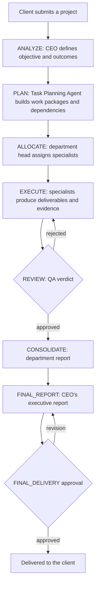

# Orchestria: Autonomous AI Agent Outsourcing Company

Orchestria is a platform where clients submit projects and a company of AI agents (a CEO, department
directors and coordinators, specialists and QA reviewers) analyzes, plans, executes, reviews and reports on
the work. People stay in charge: sensitive, expensive, irreversible or client-facing steps go through an
approval system, and each client company chooses how much the platform may decide on its own.

> **Status:** early development (v0.1.0). Fix the items under [Security status](#security-status) before
> exposing it to real users.

## Contents

- [Features](#features)
- [How a project runs](#how-a-project-runs)
- [Tech stack](#tech-stack)
- [Repository layout](#repository-layout)
- [Getting started](#getting-started)
- [Configuration](#configuration)
- [Configuring LLM providers](#configuring-llm-providers)
- [The agent company](#the-agent-company)
- [Approvals and autonomy levels](#approvals-and-autonomy-levels)
- [Accounts, roles and sign-in](#accounts-roles-and-sign-in)
- [REST API](#rest-api)
- [CLI commands](#cli-commands)
- [Testing and code quality](#testing-and-code-quality)
- [Security status](#security-status)
- [Roadmap](#roadmap)

## Features

- **Full project workflow:** from a client's request to an approved final report, with QA review and retries.
- **Agents as configuration:** one generic runner executes every agent from its definition, so agents can be
  added or tuned in `company.yaml` or in the app without changing platform code.
- **Human oversight:** approvals, clarifications, budget limits, pause, resume, retry, cancel and reassign.
- **Autopilot:** per-client autonomy levels decide routine approvals under explicit rules, and every decision
  is recorded in the audit log.
- **Client portal:** clients submit projects, answer questions, build their own specialist agents and download
  approved deliverables, isolated from other companies.
- **Staff console:** executive dashboard, departments, agents, Company Graph, live operations, supervisor
  console, reports, and client and user management.
- **Any OpenAI-compatible LLM:** OpenAI, Groq, OpenRouter, Ollama, vLLM and others, with fallback between
  providers, model tiers and a local-only mode for clients who do not allow external LLMs.
- **Sandboxed agent tools:** project files, Python execution, web fetch and knowledge search.
- **Traceable by default:** agent status, progress and costs in the UI are computed from the database, and the
  audit log doubles as the live operations feed (Server-Sent Events).

## How a project runs



Steps D to G repeat for each work package, and large work can be delegated through sub-coordinators.

Each task moves through a state machine (`backend/app/orchestration/state_machine.py`):

```
PENDING -> READY -> RUNNING -> IN_REVIEW -> APPROVED
             ^         |            |
             |         +--(error)---+--(rejected)--> READY (retry) or FAILED
             +---- AWAITING_APPROVAL / BLOCKED (human decision or intervention)
```

A task only reaches `APPROVED` with verified output: it either passes QA or, where no review is required,
passes schema validation of its structured output.

## Tech stack

| Part | Technology |
| --- | --- |
| API | FastAPI, SQLAlchemy 2, Alembic, Pydantic 2, Python 3.12, managed with [uv](https://docs.astral.sh/uv/) |
| Database | SQLite for local development; PostgreSQL 16 (psycopg 3) for docker-compose and production |
| Workers | `python -m app.worker`: threads claiming tasks through the database with leases; on PostgreSQL, `SKIP LOCKED` lets them scale horizontally |
| LLMs | Any OpenAI-compatible API, with fallback between providers |
| Web app | Next.js 15 (App Router), React 19, Tailwind CSS 4, [shadcn/ui](https://ui.shadcn.com) |
| Auth | JWT, Argon2 password hashing, optional Google sign-in |
| Sandbox | Docker containers, or subprocess for development on Linux and macOS |

## Repository layout

```
backend/
  app/
    api/            REST endpoints and the live event stream (SSE)
    orchestration/  workflow engine, task registry, state machine, agent message protocol
    agents/         generic agent runner, prompts, output schemas, company catalog (catalog/company.yaml)
    providers/      LLM provider router (OpenAI-compatible)
    tools/          agent tools: project files, sandboxed Python, web fetch, knowledge search
    governance/     human approvals, autopilot, manual controls, data retention
    worker.py       background worker
    cli.py          bootstrap, catalog sync, user creation, retention purge, autopilot, workspace export
  alembic/          database migrations
  tests/            pytest suite (uses a scripted fake LLM)
frontend/
  src/
    app/            routes: login and sign-up under (auth)/, client portal and staff console under (app)/
    components/
      ui/           shadcn/ui primitives (generated, edit sparingly)
      layout/       app shell and sidebar
      shared/       page header, stat cards, status badges, empty states, ...
      agents/ approvals/ organization/ projects/ reports/ tasks/ ...   feature components
    hooks/          React hooks generated by shadcn/ui
    lib/            API client, auth context, data hooks, formatting, types
docs/               session notes: what was built and what is left to do
docker-compose.yml  Postgres, API, worker and web app
```

## Getting started

```bash
git clone https://github.com/codeml862/Company-orchirestration.git
cd Company-orchirestration
```

### Option 1: Docker (everything at once)

```bash
cp backend/.env.example backend/.env   # then set AICO_LLM_PROVIDERS and your secrets
docker compose up --build
```

| Service | Address |
| --- | --- |
| Web app | http://localhost:3000 |
| API docs | http://localhost:8000/docs |
| Health check | http://localhost:8000/api/health |

Migrations and the bootstrap step run automatically when the `api` container starts. Sign in with
`AICO_BOOTSTRAP_ADMIN_EMAIL` and `AICO_BOOTSTRAP_ADMIN_PASSWORD` from `backend/.env` (the defaults are
`admin@orchestria.local` and `admin-change-me`).

### Option 2: Local development

Requirements: Python 3.12+, [uv](https://docs.astral.sh/uv/) and Node.js 20+. The default database is a SQLite
file, so PostgreSQL is optional (`docker compose up -d db` starts one; point `AICO_DATABASE_URL` at it).

**Backend**

```bash
cd backend
cp .env.example .env
uv sync                                  # creates backend/.venv
uv run alembic upgrade head              # create the schema
uv run python -m app.cli bootstrap       # load departments and agents, create the first admin
uv run uvicorn app.main:app --reload     # API on http://localhost:8000
```

**Worker** (in a second terminal; runs the agents and needs an LLM provider, see below)

```bash
cd backend
uv run python -m app.worker
```

**Frontend** (in a third terminal)

```bash
cd frontend
cp .env.example .env.local
npm install
npm run dev                              # http://localhost:3000
```

Add more shadcn/ui components with `npx shadcn@latest add <component>`; they land in `src/components/ui/`.

## Configuration

Backend settings use the `AICO_` prefix and are read from `backend/.env`. `backend/.env.example` documents them
and every one is optional in development. `backend/.env` is ignored by git: never commit it.

| Variable | Default | Purpose |
| --- | --- | --- |
| `AICO_ENV` | `development` | `production` enforces a non-default JWT secret |
| `AICO_DATABASE_URL` | `sqlite:///./data/aico.db` | SQLite file or `postgresql+psycopg://...` URL |
| `AICO_JWT_SECRET` | `change-me-in-production` | Token signing secret, at least 16 characters |
| `AICO_ACCESS_TOKEN_MINUTES` | `720` | Session length |
| `AICO_GOOGLE_CLIENT_ID` | empty | Enables Google sign-in |
| `AICO_ALLOW_SIGNUP` | `true` | Self-service client registration |
| `AICO_BOOTSTRAP_ADMIN_EMAIL` | `admin@orchestria.local` | First admin's email |
| `AICO_BOOTSTRAP_ADMIN_PASSWORD` | `admin-change-me` | First admin's password |
| `AICO_ENABLED_DEPARTMENTS` | empty (all) | Comma-separated department keys to load |
| `AICO_DEFAULT_AUTONOMY_LEVEL` | `autonomous` | `supervised`, `autonomous` or `full` |
| `AICO_WORKER_CONCURRENCY` | `4` | Task threads per worker |
| `AICO_MAX_PLAN_TASKS` | `40` | Largest plan the engine accepts |
| `AICO_MAX_DELEGATION_DEPTH` | `3` | Maximum levels of delegation |
| `AICO_LLM_PROVIDERS` | `[]` | JSON list of LLM providers |
| `AICO_STORAGE_DIR` | `./data/storage` | Uploads and deliverables |
| `AICO_WORKSPACE_DIR` | `./data/workspaces` | Readable project folders with `PROJECT_LOG.md` |
| `AICO_MAX_UPLOAD_MB` | `25` | Upload size limit |
| `AICO_SANDBOX_BACKEND` | `docker` | `docker`, or `subprocess` for development |
| `AICO_SANDBOX_TIMEOUT_SECONDS` | `60` | Time limit for sandbox runs |
| `AICO_SANDBOX_MEMORY_MB` | `512` | Memory limit for sandbox runs |
| `AICO_CORS_ORIGINS` | `http://localhost:3000` | Browser origins allowed to call the API |

The frontend has one setting, in `frontend/.env.local`: `NEXT_PUBLIC_API_URL` (default `http://localhost:8000`).

## Configuring LLM providers

Workers do not claim tasks until at least one provider is configured. Set `AICO_LLM_PROVIDERS` in
`backend/.env` to a JSON list, on one line. Providers are tried in order and transient errors fall through to
the next one:

```json
[
  {"name": "ollama", "base_url": "http://localhost:11434/v1", "external": false,
   "models": {"strong": "qwen3:14b", "standard": "qwen3:8b", "fast": "qwen3:4b"}},
  {"name": "groq", "base_url": "https://api.groq.com/openai/v1", "api_key_env": "GROQ_API_KEY",
   "models": {"strong": "openai/gpt-oss-120b", "standard": "openai/gpt-oss-20b"},
   "prices": {"openai/gpt-oss-120b": [0.15, 0.75]}}
]
```

- Agents pick a model by tier (`fast`, `standard`, `strong`) or with a `provider/model` override.
- `api_key_env` names the environment variable holding the key, so keys stay out of the JSON.
- Clients with "allow external LLM" turned off are only routed to providers marked `"external": false`.
- Dollar budgets only take effect for models with `prices` configured.

## The agent company

The organization is defined in `backend/app/agents/catalog/company.yaml`: departments, reporting lines and each
agent's instructions, tools, quality criteria, retries and limits.

- **Departments:** `executive`, `operations`, `technology`, `hr`, `marketing`, `sales`, `finance`, `support` and
  `research`. The workflow needs `executive` (CEO), `operations` (planning and QA) and at least one delivery
  department. Limit them with `AICO_ENABLED_DEPARTMENTS`, then run `sync-catalog`.
- **Roles:** CEO, director, coordinator, sub-coordinator and specialist.
- **Growing the company:** admins can switch on catalog departments, create custom ones and create agents in
  the app. These survive later catalog syncs.
- **Company-built agents:** clients can create their own specialists on the portal. These join one department,
  work only on that company's projects, never act as QA reviewers, and their work goes through company QA.

Agents use these tools:

| Tool | Purpose |
| --- | --- |
| `project_files.list`, `project_files.read` | Read the project's files |
| `sandbox.run_python` | Run Python in the configured sandbox |
| `web.fetch` | Fetch a web page |
| `knowledge.search` | Search earlier work |

Actions with external consequences (emails, posts, hiring decisions, payments, production changes) are never
tools: agents propose them in their output and they go through approval.

## Approvals and autonomy levels

Each client has an autonomy level that decides who answers each kind of approval. Autopilot decisions go through
the same path as human ones and are recorded in the audit log with the rule that produced them.

| Approval | `supervised` | `autonomous` (default) | `full` |
| --- | --- | --- | --- |
| Clarification | Person | Autopilot, after waiting 24h for the client | Same as autonomous |
| Budget overrun | Person | Autopilot, up to 2 extensions per task and 2 per project | Same as autonomous |
| Final delivery | Person | Autopilot quality gate, up to 2 revision rounds | Same as autonomous |
| External action, spend, hiring | Person | Person | Autopilot |
| Production change, irreversible action | Person | Person | Person |

When a rule's limit is reached, the approval stays pending in the supervisor console, marked as escalated with
the reason. Only supervisors and admins can change a client's autonomy level.

## Accounts, roles and sign-in

| Role | Can |
| --- | --- |
| admin | Everything, including managing users and creating agents |
| supervisor | Approvals (spend, external actions, final delivery), budgets, all staff screens |
| operator | Manage projects, clients and agent configuration; answer clarifications |
| client | Submit projects, answer questions and download approved deliverables, for their own company only |

- **Sign-up** (`/signup`) registers a client company and its first user. Self-registered clients start with
  "allow external LLM" off until staff change it. Set `AICO_ALLOW_SIGNUP=false` for invite-only accounts.
- **Staff accounts** are never self-service: an admin creates them on the **Clients & Users** page or with
  `python -m app.cli create-user`.
- **First admin:** `backend/.env` owns this login. The API applies the email and password on every start, so a
  password changed in the app is reset to the `.env` value on the next restart.

### Sign in with Google

1. In the [Google Cloud console](https://console.cloud.google.com/apis/credentials), create an **OAuth client
   ID** of type **Web application**.
2. Add the web app's origin (for example `http://localhost:3000`) under **Authorized JavaScript origins**.
3. Put the client ID in `AICO_GOOGLE_CLIENT_ID` and restart the API.

"Continue with Google" signs in an existing, active user with that email; "Sign up with Google" registers a new
client company. The API verifies Google's ID token, and roles and client isolation always come from Orchestria.

## REST API

Interactive documentation is at http://localhost:8000/docs. The main groups, all under `/api`:

| Area | Endpoints |
| --- | --- |
| Auth and users | `/auth/login`, `/auth/signup`, `/auth/google`, `/auth/google/signup`, `/auth/providers`, `/auth/me`, `/users`, `/clients` |
| Projects | `/projects`, `/projects/{id}` and its `submit`, `pause`, `resume`, `cancel`, `feedback`, `tasks`, `timeline`, `messages`, `artifacts`, `files` |
| Tasks | `/tasks`, `/tasks/{id}` and its `retry`, `cancel`, `reassign` |
| Organization | `/departments`, `/agents`, `/company/agents`, `/org-chart`, `/tools` |
| Approvals | `/approvals`, `/approvals/{id}/decide` |
| Deliverables | `/submissions`, `/submissions/{project_id}`, `/artifacts/{id}/download` |
| Monitoring | `/health`, `/dashboard/executive`, `/dashboard/quality`, `/dashboard/departments/{key}`, `/events`, `/events/stream` |

## CLI commands

Run these from `backend/`:

```bash
uv run python -m app.cli bootstrap                 # sync the catalog and apply the first admin's login
uv run python -m app.cli sync-catalog              # reload departments and agents from company.yaml
uv run python -m app.cli create-user ops@example.com operator --name "Ops"
uv run python -m app.cli autopilot                 # decide pending approvals once (workers do this continuously)
uv run python -m app.cli export-workspace          # rewrite readable project folders in data/workspaces
uv run python -m app.cli purge-expired             # delete finished projects past their client's retention period
```

`create-user` reads the password from `AICO_NEW_USER_PASSWORD` or prompts for it (at least 10 characters).

## Testing and code quality

```bash
# Backend, from backend/. Without AICO_DATABASE_URL, tests expect the aico_test PostgreSQL database.
AICO_DATABASE_URL=sqlite:///./data/test.db uv run pytest
uv run ruff check .

# Frontend, from frontend/
npm run typecheck
npm run build
```

Known test failures on native Windows: the sandbox tests and one workflow test need the Linux or macOS subprocess
sandbox. Two tests also use `.test` email addresses that the email validator rejects.

### Windows notes

The `subprocess` sandbox relies on POSIX resource limits and does not run on native Windows, and the `docker`
sandbox needs Docker Desktop. Use Docker Desktop, or run the backend under WSL, for agents that execute code.

### Production notes

Set `AICO_ENV=production`, a strong `AICO_JWT_SECRET` and `AICO_BOOTSTRAP_ADMIN_PASSWORD`, use PostgreSQL and the
`docker` sandbox backend. The API refuses to start with the default JWT secret in production. The included
`docker-compose.yml` is for local use: it exposes Postgres with a development password and has no HTTPS.

## Security status

This project is not ready for public deployment. Known gaps are tracked in
[docs/sessions/2026-10-28.md](docs/sessions/2026-10-28.md), including email verification and rate limiting on
authentication.

## Roadmap

1. Autonomy engine (done)
2. Safety limits: company-wide spend cap, stuck-agent detection, emergency stop, alerts
3. A shared Git workspace per project, with QA reviewing diffs and running tests
4. Real integrations: GitHub, deployment, email, and per-client credentials in a vault
5. Automatic client communication: progress updates, feedback and revision rounds
6. Quotes and payments
7. Memory and learning from past work and QA rejections
8. An evaluation suite to measure quality
9. Cost control: model routing by difficulty, per-model prices and caching

Session notes are in [docs/](docs/README.md).
